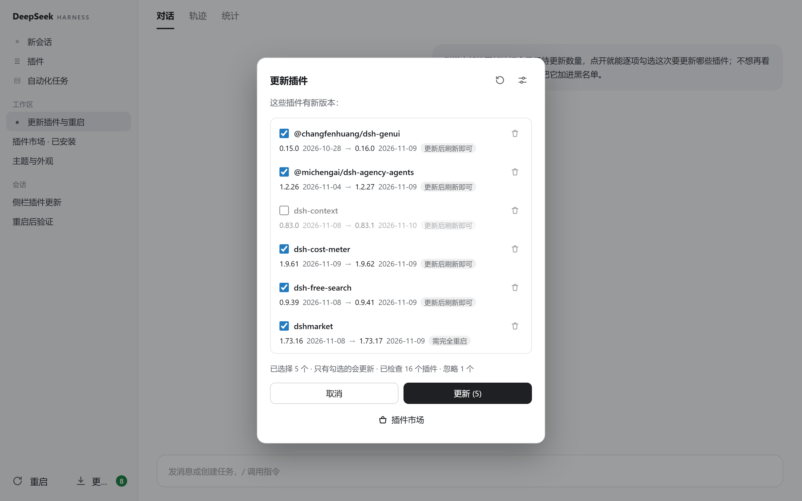
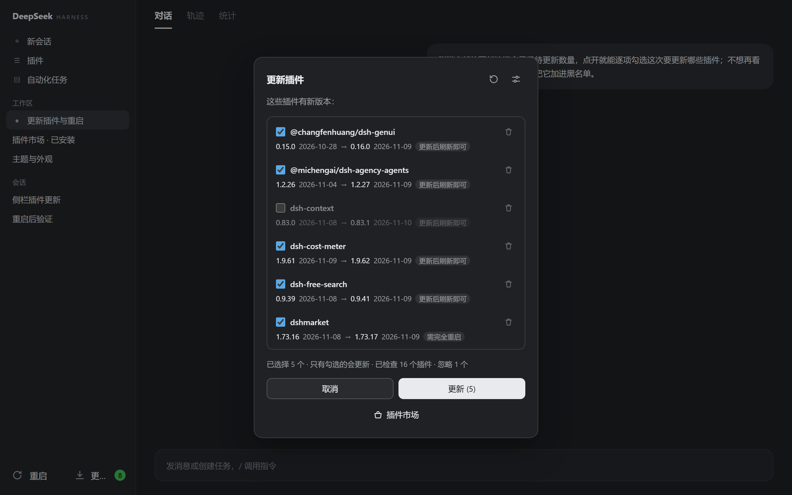
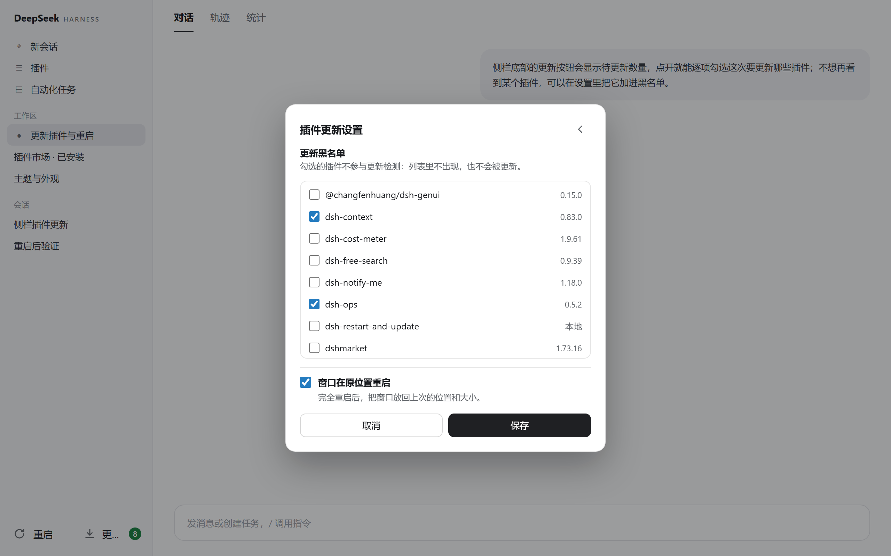
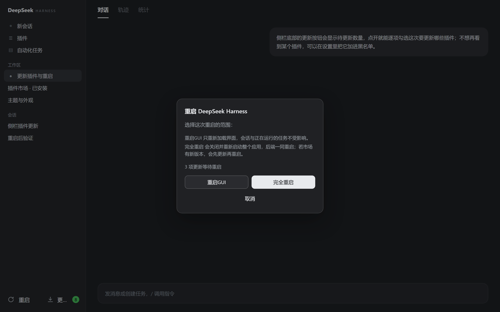
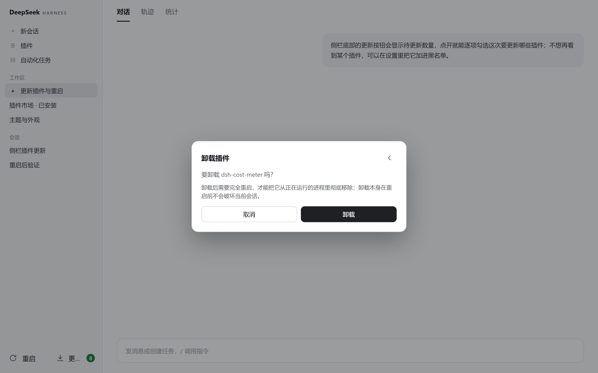

# dsh-restart-and-update

A DSH plugin: the **Restart** and **Update plugins** buttons in the sidebar footer, and the dialogs behind them.

**Update plugins and restart Harness from the sidebar.** The update button carries a count; the dialog lists every
plugin's current and new version with publish dates, lets you check exactly which ones this batch updates, keeps a
**blacklist** of plugins you never want touched, and uninstalls from the same list. When the batch is done the button
becomes **Restart**; with nothing to update it opens the plugin market instead.

| Update plugins | Pick rows + uninstall |
|---|---|
|  |  |
| **Settings: blacklist and window memory** | **Updated → restart** |
|  |  |
| **Uninstall confirmation** | |
|  | |

## The interface

- **Footer row**: one `sidebar.footer.action` registration draws both buttons.
  - Left: **Restart** — the orange badge counts updates that are applied (or queued) and waiting to load, not updates
    that merely exist.
  - Right: **Update plugins** with a green count while updates exist; **Plugin market** when none do.
  - Collapsed into the 56px rail, both become 36×36 icons with the badge as a corner dot.
- **Update dialog**: the title row ends with two icon buttons — **check again** (↻) and **settings** (⚙).
  Below: a scrollable list, then `Cancel` / `Update (n)`, then the full-width **Plugin market** row.
  - **Every row starts with a checkbox and every row starts checked**; only checked rows are updated, and the number
    on the button is the number of checked rows. Unchecking dims the row without touching the others.
  - A small **uninstall** icon sits at the right end of the plugin-name row. It switches the dialog to a
    confirmation page; only confirming runs the removal.
  - The tail still marks `needs restart` / `reload after updating` — see the next section for what that means now.
- **Settings page**: the ⚙ in the title row switches the *same* dialog (no second overlay). The title turns into a
  back arrow and the footer becomes `Cancel` / `Save`.
  - **Update blacklist**: every installed plugin in the profile, `link:`/`file:` local packages included, each with a
    checkbox. A checked plugin is completely ignored by the update check: not listed, not counted, never updated.
    A checkbox in the update list only means "skip this batch" and has nothing to do with the blacklist.
  - **Reopen the window where it was**: whether a full restart puts the window back at its previous position and size.
    Windows desktop only; elsewhere the switch is disabled with the reason next to it.
  - Stored in `$DSH_HOME/restart-and-update.json` (default `~/.dsh/restart-and-update.json`) and applied
    immediately on save — no second restart needed.
- **When it checks**: 300ms after the client module mounts and again whenever the window becomes visible. The Host
  caches registry documents for ten minutes; the title-row refresh button bypasses that cache and asks the registry
  again.

## "Needs a restart" — reviewed

**Conclusion for v1.2.1**: "every plugin needs a full restart" was not a false alarm, but the old build hard-coded
"has a Host half ⇒ restart", which reads as a bug when all 16 installed plugins are bundles. The answer is computed
now:

1. **Does the package have a Host half?** Same rule the market uses (`hasHostHalf`: `dsh.client` without
   `dsh.bundle` is client-only). A client-only change is picked up by the next page load → `reload is enough`.
2. **Can the running Host replace the old modules?** DSH 0.2.2's profile HMR service compares the loaded modules with
   disk, stops the stale ones and recomposes from the new bundle patches — without restarting. After the batch lands,
   the plugin asks it to reconcile once:
   - reconciled → those plugins need **no** full restart (the page reload shows the new client half), and the restart
     button does not count them;
   - refused (no HMR service, or it reports a profile-wide restart reason) → the row keeps `needs restart` and the
     packages go into the pending list.
3. So each row describes **what this update actually costs**, not a static property of the plugin. A Host without HMR
   (older, or a CLI host) falls back to the conservative "Host half ⇒ restart" answer automatically.

## Two kinds of restart

| Button | What it does | Effect |
|---|---|---|
| Restart GUI | `location.reload()` | Reloads the front end and refetches client plugin bundles; the Host, sessions and running turns keep going |
| Restart everything | A worker outside the process tree **ends the app first**, optionally updates the market (bounded to 120s), then starts it again | The whole app, Host included, restarts; logs stay in the temp directory |
| Cancel | Closes the dialog | Nothing |

**Platforms**: the same three the desktop app ships for — Windows, macOS and Linux.

- Windows uses two PowerShell scripts started through WMI `Win32_Process.Create`, so the worker's parent is
  WmiPrvSE and `taskkill /T` cannot reach it. The replacement is created by WMI as well: a child would inherit the
  worker's console and die with it when that window is closed.
- macOS / Linux use a `sh` worker in its own session (`detached`). It waits for the old processes to exit, then
  reopens the `.app` through `open -n` on macOS and `nohup`s the binary everywhere else.
- A bare `node` CLI host is out of scope (there is no desktop app to relaunch); the state route says so.

## Window memory (switchable)

The shell always builds its BrowserWindow at `1280×820` and exposes no window-geometry IPC, so this plugin fills the
gap — on Windows:

- **How the handle is found**: the Host's `process.ppid` is the Electron main process; `FindWindowExW` walks its
  `Chrome_WidgetWin_1` windows, and measuring/moving goes through `user32.dll` (koffi, shipped with the desktop app).
- **No flash**: the window is created hidden before the Host boots, so the restore happens before it is ever shown.
- **How it is recorded**: sampled every 250ms while visible, written atomically 800ms after a change to
  `~/.dsh/window-state.json`.
- **The switch**: "Reopen the window where it was" in the settings page. Off means neither recording nor restoring,
  applied immediately.
- **Scope**: Windows desktop only; elsewhere the setting is reported as unavailable.

`GET /dsh-restart-and-update/state` reports `windowState`, `windowStateSupported`, `canApplyLive` and
`restartMode` for troubleshooting.

## Updating plugins

- **Check**: `GET /dsh-restart-and-update/updates` (`?refresh=1` bypasses the cache) reads the profile manifest,
  queries `registry.npmjs.org` per npm dependency (the full packument — the abbreviated one has no `time`), compares
  semver and returns `{name, installedVersion, installedAt, latestVersion, latestAt, hostHalf, needsRestart}`, plus
  `installed` (the blacklist editor's list), `ignored` (blacklisted and skipped), `settings`, and two independent
  lists:
  - `updatable` / `packages` — updates not applied yet; drives the green badge.
  - `pendingCount` / `pending` — applied or queued but not loaded; drives the orange restart badge.
  Neither is derived from the other: before Update is pressed the restart button has no number.
- **Apply**: `POST /dsh-restart-and-update/update` with `{names:[...]}` (the checked rows only) and the
  `x-dsh-restart-and-update: full` header. Runs the shipped launcher,
  `dsh plugin --profile <p> add <name>@<exact version>` — the same installer the market uses.
  - An exact version, not `@latest`: pnpm's release-age hold answers "already up to date" to `@latest` while
    nothing moves.
  - The disk is read back after each install; a mismatch is a failure, with the version that actually landed.
  - A blacklisted package is refused even when named directly (`code: blacklisted`).
  - One profile reconcile after the batch decides which packages really still owe a restart (see above).
- **Uninstall**: `POST /dsh-restart-and-update/uninstall` with `{names:[...]}` and the confirmation header. Runs
  `dsh plugin --profile <p> remove <name>` and verifies the package is gone from disk; pending rows for it are
  dropped. The plugin cannot uninstall itself while it is the one asking.
- **dshmarket itself**: it owns the running bundle and cannot replace itself, so the update route records it as
  `deferred` and puts it in the pending list (`deferred: true`). The restart worker installs it before the app goes
  away, and skips the step entirely (`update-skipped`) when there is no newer version.

## Implementation

- Host half `index.js`: seven exact `webServer.register` routes
  - `GET  /dsh-restart-and-update/state` → platform, exe, `canRestart`, `restartMode`, `canApplyLive`,
    `windowStateSupported`, profile, market facts, `windowState`
  - `GET|POST /dsh-restart-and-update/settings` → read and save the blacklist and the window switch
  - `GET  /dsh-restart-and-update/updates` → the update list (blacklist applied, publish dates, restart class)
  - `POST /dsh-restart-and-update/update` → apply updates, live where possible
  - `POST /dsh-restart-and-update/uninstall` → remove plugins
  - `POST /dsh-restart-and-update/install-market` → install dshmarket
  - `POST /dsh-restart-and-update/restart` → restart (`{"updateSelf":false}` skips the market self-update)
  - Every write requires `x-dsh-restart-and-update: full` (a cross-origin page cannot send it) and a same-origin
    `Origin`/`Host` pair. One package operation at a time.
- `lib/settings.js`: read, normalise and atomically write the settings document.
- `lib/relaunch.js`: platform support, the launcher path inside the installation, shell quoting, the POSIX worker.
- `lib/window-state.js`: koffi `user32` bindings, restore while hidden, 250ms sampling, 800ms debounce.
- Tests (`npm test`, no Windows window required — a fake Win32 surface is injected):
  `test/settings.test.mjs`, `test/relaunch.test.mjs`, `test/window-state.test.mjs`.
- Client half `client.js`: `window.__ModuleLoader__.load`; slots `sidebar.footer.action` and `shell.overlay`;
  the update dialog switches between list / settings / uninstall in place; copy goes through
  `ctx.locale.register` in zh and en; styling reads the `--dsw-alias-*` theme variables.

## Install

```sh
dsh plugin add dsh-restart-and-update
```

Compatible with Node.js 20+ and dsh `>=0.2.0-rc.1 <0.3.0-0`.

## Development

```sh
git clone https://github.com/dolacmeo/dsh-restart-and-update.git
dsh plugin add <the checkout>
```

The Host half (`index.js`, `lib/`) is loaded at boot: after changing it, run
`dsh plugin remove dsh-restart-and-update` and add it again.

## Publishing

`publishConfig.registry` is pinned to `https://registry.npmjs.org`. The release workflow verifies that a `v*` tag
matches `package.json` and creates the GitHub Release; uploading to npm is still a manual `npm publish`.
