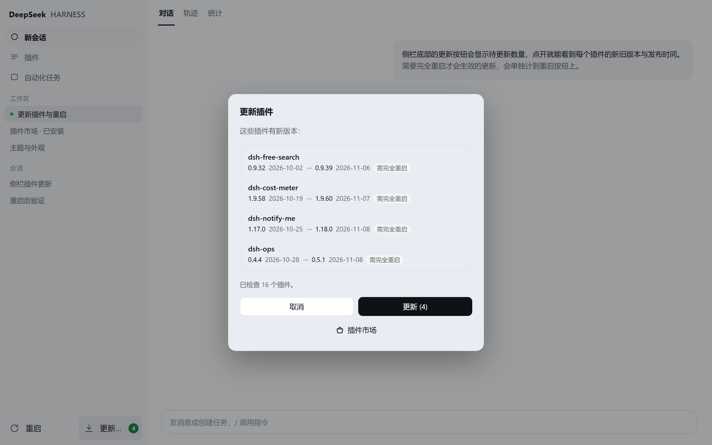
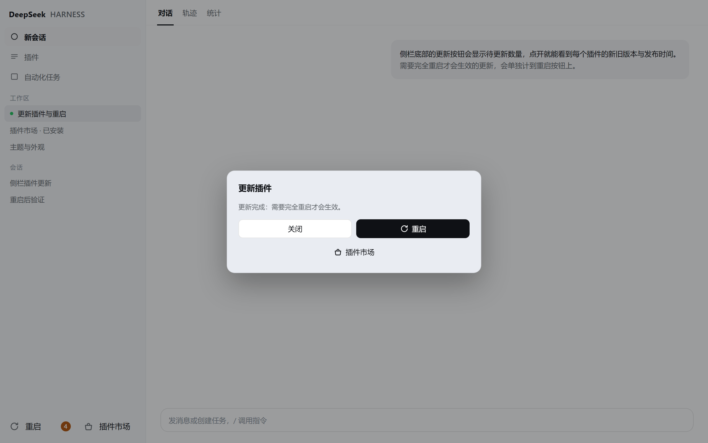
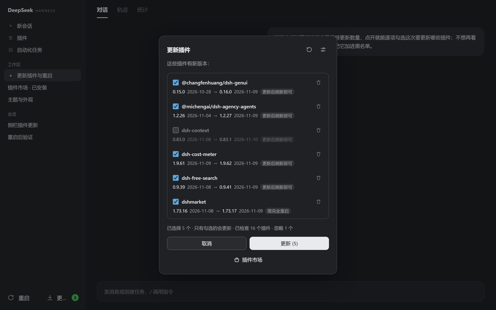
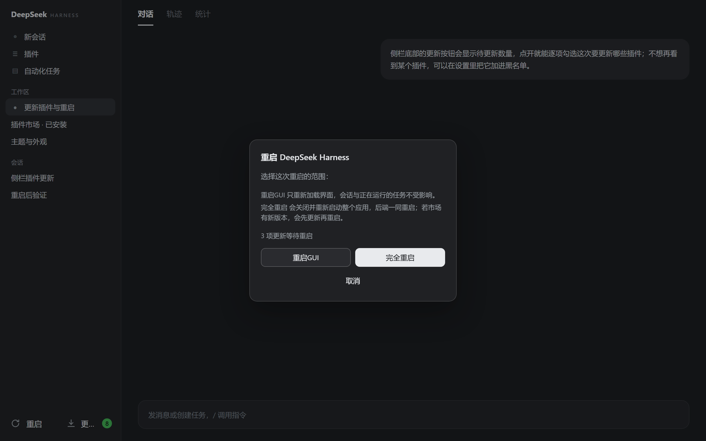

# dsh-restart-and-update

DSH 插件：侧栏底部动作行里的「重启」+「更新插件」两个按钮，以及各自的弹窗。

**侧栏一键更新插件与重启 Harness。** 更新按钮带待更新数量，点开能看到每个插件的当前/新版本与发布时间；
更新完成后按钮直接变成「重启」，一键交接给重启弹窗。没有更新时，它就是插件市场入口。

| 更新插件 | 更新完成 → 重启 |
|---|---|
|  |  |
|  |  |

## 界面

- **入口行**：侧栏 `footArea` 里的 `sidebar.footer.action`（官方说明：设置按钮旁的可选动作），
  排在官方/第三方条目之后（order 1000）。**两个按钮共用这一行**，靠一次注册同时画出：
  - 左：「重启」——44px 行高、左侧 24px 图标位 + 18px 箭头图标、右侧文字。
    **只有已经应用或已排队、等着重启生效的更新才会让它出现橙色提醒 badge**
    （亮色/暗色两套橙色调，保证数字对比度），tooltip 写「N 项更新等待重启」；
    只是"有更新可选"并不会让重启按钮出现数字 —— 那是更新按钮的事。
    重启弹窗里也复述同一句。
  - 右：**有更新时**是「更新插件」（图标为向下箭头落到横线），带绿色数量 badge
    （暗色下换成亮绿底 + 深色数字，保证对比度）；
    **没有更新时**变成「插件市场」（提包图标），点击在本插件自己的浮层里打开市场面板
    （见下面「插件市场」一节；不是切 `dsh-market` 面板 —— 那个 key 默认不存在）。
  - 侧栏收进 56px 轨道时两个按钮退成 36×36 图标，badge 变成右上角小圆点。
- **重启弹窗**：标题 + 说明 + 两行按钮 —— 第一行 `重启GUI` / `完全重启`，第二行 `取消` 独占通栏。
- **更新弹窗**：标题 + 说明 + 可滚动插件列表（每行：插件名、当前版本 + 发布时间 → 新版本 + 发布时间，
  行尾标 `需完全重启` / `刷新即可`），底部 `取消`（左）/ `更新 (n)`（右），再下面一行是通栏
  「插件市场」按钮；点击会关闭更新弹窗并直接打开市场浮层。
  - **更新完成后**，右下的主按钮变成 `重启`（带刷新图标）；点击关闭更新弹窗并打开重启弹窗，
    不会留下一个点不动的按钮。
  - 列表 `max-height: min(52vh, 420px)` + `overflow-y:auto`，卡片本身
    `max-height: calc(100vh - 48px)`，列表再长也只滚动列表，不会把按钮挤出屏幕。
- **检测时机**：客户端模块挂载后 300ms 检测一次（即页面/应用启动后就有 badge），
  另外每次窗口重新可见时再检测一次；Host 侧 packument 有 10 分钟缓存，重复检测很便宜。

## 两种重启的区别

| 按钮 | 行为 | 影响 |
|---|---|---|
| 重启GUI | 浏览器页面 `location.reload()` | 只重载前端，重新拉取客户端插件代码；后端、会话、正在跑的任务都不受影响 |
| 完全重启 | Host 路由 `POST /dsh-restart-and-update/restart` 拉起一个脱离进程树的 PowerShell worker：可选先跑一次插件更新 → `taskkill /T /F` 杀掉整个应用 → 重新启动 `DeepSeek Harness.exe` | 整个应用重启，后端一起重启；日志落在 `%TEMP%\dsh-restart-and-update\restart-*.log` |
| 取消 | 关闭弹窗 | 无 |

## 记住窗口位置

桌面壳自己不会记窗口位置：每次都把 BrowserWindow 建成 `1280×820`，而且没有任何窗口几何的 IPC
（`DESKTOP_IPC` 里只有文件/剪贴板/主题这一路通道，Host↔Electron 的 IPC 也只有 `shutdown`、
`file-drag-*`、`quit-inspection`、`update-tasks`、`ready`）。所以「完全重启」之后窗口总掉回默认角落。
这个插件顺手把它补上了：

- **怎么拿到窗口**：Host 就是 Desktop Host 进程，`process.ppid` 是 Electron 主进程，
  用 `FindWindowExW` 枚举它的 `Chrome_WidgetWin_1` 就是主窗口；测量和移动都走 `user32.dll`
  （桌面版自带的 koffi），不读 DSH 内部结构，升级不受影响。
- **为什么不闪**：主窗口在 Host 启动**之前**就以 `show: false` 创建，Host ready 之后才 `show()`，
  恢复发生在窗口还没显示的时候。上次是最大化就先铺满工作区，窗口可见的一瞬间再
  `ShowWindow(SW_MAXIMIZE)`，不会先闪一个小窗口。
- **怎么记**：窗口可见时每 250ms 采样 `GetWindowRect`/`IsZoomed`（隐藏、最小化时跳过），
  变化后 800ms 原子写入 `~/.dsh/window-state.json`（`DSH_HOME` 生效时跟着走），Host 退出时再存一次。
- **坐标系**：状态文件里是物理像素（宿主是 per-monitor DPI 感知的），读和写同一套坐标，不换算。
  显示器变了会自动收敛：矩形至少要有 160×120 落在某个工作区内，否则居中，尺寸不超过工作区。
- **兜底**：所有 Win32 调用都在 `try/catch` 里，连续失败 20 次就停止采样。插件里未捕获的异常会
  带走整个 Host，所以这段代码不允许有异常逃出去。
- **范围**：仅 Windows 桌面版。直接用 `node` 跑的 CLI 宿主没有 Desktop 窗口，这段逻辑不会启动。
  删掉状态文件只是忘掉位置；要彻底关掉就停用本插件。

`GET /dsh-restart-and-update/state` 多返回一个 `windowState` 字段（`bounds` / `maximized` / `stateFile` / `found`），
排查时可以直接看。状态文件长这样：

```json
{
  "version": 1,
  "updatedAt": "2026-11-09T08:13:00.000Z",
  "bounds": { "x": 2, "y": 11, "width": 2076, "height": 2078 },
  "maximized": false
}
```

## 插件市场

没有待更新插件时，第二个按钮变成「插件市场」；更新弹窗里也有同样的入口。
点击后由本插件开一个全屏浮层，里面是市场自己的面板（`discover` 分栏）。

- **为什么不是 `selectPanel('dsh-market')`**（之前的错误做法）：市场的侧栏面板
  **默认关闭**（市场源码注释：*Off by default*），所以 `main` 槽位里根本没有 `dsh-market` 这个 key，
  选中它是个静默空操作 —— 这就是之前"点了没反应"的原因。
- **现在的做法**：用市场公开的 client service —— `ctx.get('market')`，
  它的 `render({preferredSubsectionId:'discover'})` 返回市场整块面板（自带错误边界）的 React 元素。
  README（`UPDATE-API-V1.md`）明确这是"把市场渲染进自己的容器"的官方途径。
  元素每次打开时构建一次、关闭即丢弃，避免每次 store 通知都重建市场面板。
- **市场没装时**：浮层不是空白提示，而是一个安装确认框 ——
  「插件市场没有安装 / 这个按钮需要 dshmarket 插件。要现在安装吗？」
  左 `取消`、右 `安装`。点安装走 `POST /dsh-restart-and-update/install-market`
  → `dsh plugin --profile <p> add dshmarket@<最新版本>` → 回读磁盘版本校验，
  成功后提示「已安装（版本号），重启后可用」并直接给一个 `完全重启` 按钮。
  市场装好但当前进程没提供界面时（刚装完还没重启、或被停用），文案换成
  「已安装但未加载」并给 `打开插件页`。
- **回退**：若服务取不到，就 `layout.selectPanel('plugins')` 跳到插件页（市场的 Discover 是它里面的一个 tab）。
- **Client 半的 `ctx` 是受限接口**：只有 `get` / `on` / `provide` / `effect`，
  **没有 `inject`、没有 `reflect`**。所以这里一律用 `ctx.get(name)` + undefined 判断，
  绝不能用 `ctx.inject(...)` —— 那会直接抛异常把整个客户端插件搞挂。

## 更新插件

- **检测**：`GET /dsh-restart-and-update/updates` 读 profile 的 `package.json`，只对 npm 依赖逐个查
  `registry.npmjs.org`（完整 packument，因为缩略版不含 `time`），比较 semver，返回
  `{name, installedVersion, installedAt, latestVersion, latestAt, needsRestart}`，外加两份互相独立的清单：
  - `updatable` / `packages` —— **还没更新**的插件，驱动更新按钮的绿色 badge。
  - `pendingCount` / `pending` —— **已经应用或已排队（含 dshmarket 延迟更新）、还没被加载**的更新，
    驱动重启按钮的橙色 badge。
  两者互不派生：没按更新之前，重启按钮永远没有数字。
  `pending` 记在 Host 的 `%TEMP%\dsh-restart-and-update\pending-updates-<profile-hash>.json`（不是页面状态），
  每个 profile 一份；所以刷新页面不会让它消失；真正「完全重启」时先清空，worker 创建失败会回滚。
  读取时还会按"当前磁盘版本 == 记录里的版本"过滤，插件若又变过就自动掉出清单；
  已在 pending 里的包不会再次出现在更新清单里（避免把已排队的市场更新又提示一遍）。
- **刷新还是重启（调查结论）**：判定规则直接采用市场自己的 `hasHostHalf`
  （`dshmarket/lib/verify.js`）：manifest 里 `dsh.bundle === undefined && dsh.client !== undefined`
  才是纯客户端插件 —— 它没有服务端代码，下次页面加载就从磁盘取到新 bundle，**刷新即可**；
  其余（含声明了 `dsh.bundle` 的、以及 `"dsh": {}` 的）都有 Host 半，运行中的进程仍在用启动时
  import 的旧模块，**必须完全重启**。市场自己的 `activationAfterReplace` 也是同一结论：
  host half 曾经 live 的更新，状态一律被改写成 `restart`。
  这条判定只决定"更新完成后进不进 pending 清单"，不决定重启按钮在更新之前显示什么。
  实测本机 16 个 npm 插件全部 `hostHalf=true`（因此纯客户端那条分支暂无真实样本）。
- **执行**：`POST /dsh-restart-and-update/update`，body `{names:[...]}`，需要 `x-dsh-restart-and-update: full`。
  走桌面端自带的 `resources/runtime/cli/bin/dsh.cmd` → `dsh plugin --profile <p> add <name>@<精确版本>`，
  与市场自己用的安装器同一条路径，没有另造一套。
  - 用**精确版本**而不是 `@latest`：`@latest` 会被 pnpm 的 release-age 策略挡下却仍报成功（实测版本原地不动）。
  - 装完回读 `node_modules/<name>/package.json` 校验磁盘版本；对不上就判失败并给出实际版本。
- **dshmarket 自己**：它拥有正在运行的 bundle，不能自我替换，所以更新接口把它记为 `deferred`，
  同时写进 pending（`deferred: true`），重启 badge 立即出现、更新清单不再重复提示它；
  真正的安装交给「完全重启」的 worker 在杀进程前执行。**没有新版本时 worker 直接跳过更新步骤**（`update-skipped`）。

## 实现

- Host 半 `index.js`：`webServer.register` 五条 exact 路由
  - `GET  /dsh-restart-and-update/state`   → 平台、exe、`canRestart`、profile、`marketInstalled` / `marketVersion`、`windowState`
  - `GET  /dsh-restart-and-update/updates` → 更新清单（含发布时间、`needsRestart` 分类）
  - `POST /dsh-restart-and-update/update`  → 执行更新
  - `POST /dsh-restart-and-update/install-market` → 安装 dshmarket（市场缺失时按钮触发）
  - `POST /dsh-restart-and-update/restart` → 重启（可带 `{"updateSelf":false}` 跳过市场自更新）
  - 写操作都要求 `x-dsh-restart-and-update: full`（跨源页面带不上自定义头，预检被拒，等于 CSRF 挡板）
    并且校验 `Origin` 与 `Host` 同源。
  - worker 用 WMI `Win32_Process.Create` 启动（父进程是 WmiPrvSE），所以 `taskkill /T` 杀不到它；
    脚本只带 start PID / exe 路径 / 日志路径 / 更新命令，**不落任何凭据**。
  - **重启后的应用必须由 WMI 创建，不能是 worker 的子进程**。worker 由 WMI 启动时仍带一个
    console 宿主；Chromium（Electron 主进程）启动时会 `AttachConsole(ATTACH_PARENT_PROCESS)`
    认领父进程的 console。若应用是 worker 的子进程，它就会认领那个 console：worker 退出后
    窗口残留，用户关掉它 → 走 `CTRL_CLOSE_EVENT` → 整个 Harness 被杀。
    `Win32_Process.Create` 由 WmiPrvSE 执行、后者没有 console，应用便无从认领。
    实测（用一个会 `AttachConsole` 的 GUI 替身）：子进程路径 `attachParent=True` 且
    `consoleWindow` 与 worker 相同；WMI 路径 `attachParent=False, consoleWindow=0`。
  - worker 还会 `ShowWindow(GetConsoleWindow(), SW_HIDE)` 作为第二道保险。
  - `Start-Process` 只作最后兜底：它会把 worker 的 console 传给应用，只在 WMI 创建失败时使用。
- 窗口记忆 `lib/window-state.js`：koffi 绑定 `user32`（FindWindowExW / GetWindowRect / SetWindowPos /
  IsZoomed / ShowWindow / MonitorFromRect），启动时在窗口隐藏期间恢复，之后 250ms 采样、800ms 防抖落盘；
  状态文件 `~/.dsh/window-state.json`。所有调用都在 try/catch 内，采样连续失败 20 次自动停。
- 单测 `npm test`（`test/window-state.test.mjs`，7 条，不需要 Windows 窗口，注入假 Win32 面）：
  工作区收敛、坏状态文件、首次启动种状态、隐藏窗口恢复、异常吞噬、隐藏窗口不记录。
- Client 半 `client.js`：`window.__ModuleLoader__.load`
  - 槽位：`sidebar.footer.action`（两按钮，order 1000）、`shell.overlay`（重启弹窗 order 900、
    更新弹窗 order 901、市场浮层 order 902）
  - 无更新时第二个按钮变成市场入口：优先 `ctx.get('market').render(...)` 把市场面板嵌进本插件浮层；
    取不到服务时才回退到 `layout.selectPanel('plugins')`。
  - 文案走 `ctx.locale.register` + `bind`，zh/en 两套
  - 样式以 `--dsw-alias-*` 主题变量为主；绿色/橙色 badge 用亮暗两套固定色，
    避免暗色下品牌色反白导致数字不可见。

## 安装

```sh
dsh plugin add dsh-restart-and-update
```

版本兼容：Node.js 20+，dsh `>=0.2.0-rc.1 <0.3.0-0`。
「完全重启」目前只在 Windows 上有实现；「重启GUI」各平台都可用。

## 开发

```sh
git clone https://github.com/dolacmeo/dsh-restart-and-update.git
dsh plugin add <克隆下来的目录>
```

改 Host 半（`index.js`）后需要卸载重装以换掉已加载的模块代际：
`dsh plugin remove dsh-restart-and-update` 然后重新 add。

## 发布

`package.json` 里写死了 `publishConfig.registry = https://registry.npmjs.org`，
所以本机 `.npmrc` 指向镜像（npmmirror / cnpm）也不会把包发错地方 ——
**npmmirror 是官方 npm 的只读镜像，不承接发布**，发到官方之后它自己会同步。

发布走 CI（`.github/workflows/release.yml`）：仓库里配好 `NPM_TOKEN` secret 后，
打 `v*` 标签即自动 `npm publish --provenance`，并先校验标签与 `package.json` 版本一致。
